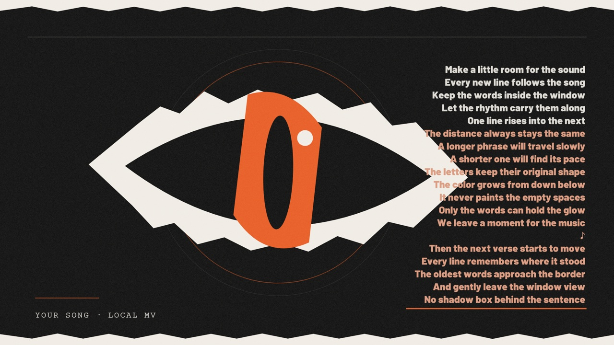

# 视频工作台 · Video Workbench

本地 **Remotion + HyperFrames + 34 个 Skills** 的视频工作台。给本地 AI 一段音频和一份歌词文件，就能按固定字幕规范制作 MV；画面依音乐重新创作，字幕使用同一套传送带与字形内进度效果。



这是一个可以继续开发的本地项目，含工作台网页、两个引擎示例、六组剪纸视觉模板、完整 AI 操作提示、固定版本的官方 Skills 安装清单和可运行字幕脚本。网页负责启动编辑器和演示导出；**聊天里的 AI 读取 Skill 再操作工具**，网页本身不含聊天模型。

## 让朋友的 AI 开始

给能运行本地命令、读写文件的 AI 这段话，并附上音频与字幕路径：

```text
请克隆 https://github.com/eksinge/video-workbench，先读取根目录 AGENTS.md，
再读取 skills/video-workbench/SKILL.md、references/lyric-workflow.md 和 references/lyric-style.md。
安装并检查本地依赖，用我提供的音频和 MD 制作 MV。
画面按歌曲风格用 Remotion 或 HyperFrames 制作；字幕必须遵守仓库当前样式：
MD 每个非空换行一句、逐句审核实际演唱时间、40px 行距、连续向上传送带、
间奏暂停、上下窗口裁切、全曲橙色进度只填在文字及音符内部。
下方橙线从视频0秒向左加载，实际首句开唱时填满，速度按本曲前奏适配；
上方白线左右对称延至x=86..1834。
时间偏移默认 0，按这首歌的实际情况调整，不能套用作者参考歌曲的 -0.6 秒。
每次新版验证可用后，只保留该项目最新三个成片导出。
```

如果只是普通网页聊天、没有本地工具权限，AI 可以读说明，但不能替你在电脑上安装和渲染。详细步骤和可复制指令见 [AI 制作流程](docs/AI-WORKFLOW.md) 与 [完整提示词](docs/AI-PROMPTS.md)。

## 字幕效果固定什么

| 项目 | 默认规范 |
|---|---|
| 画布 | 1920×1080，30fps |
| 字体 | Barlow Black，ASS 字号42；随包提供实际字体和 OFL 许可 |
| 字色 | 米白 `#F0ECE5`，透明底、无阴影无描边 |
| 布局 | 右对齐 x=1830，行距40px |
| 窗口 | y=115..964；从下边逐渐露出，从上边逐渐裁掉 |
| 滚动 | 整列连续上移，每句按实际演唱时长前进一行；短换气连续，间奏暂停 |
| 橙色进度 | `#E85D26`，50%叠色，从下向上，只在文字/音符的字形内显示 |
| 进度时钟 | 新曲默认随全曲时长填满；可指定 `--progress-seconds 240` |
| 前奏横条 | x=1834向左加载至实测最长行左界，视频0秒开始、实际首句开唱填满并保持；4px高，速度随每首歌前奏适配 |
| 上方白线 | x=86..1834、y=115，两端各延24px，保持中心对称，全部场景一致 |
| 时间偏移 | **0秒**，每个项目根据实际情况单独调整；不影响前奏进度时钟 |
| 版本 | 每项目只保留最近三个已验证导出 |

前奏横条与字形内全曲进度是两个独立效果；前者本身是可见实线，后者保持字外透明。11.95秒仅为参考歌的开唱点，其他歌曲不得照搬。

音符 `♪` 也参与字形遮罩。字母内部的孔、字外和行间不会出现橙色矩形。历史歌词不会缩小、变淡或唱完消失。图案全部位于歌词下面；同为米白的图案和文字仍可能同色融合，不通过擅加黑底/描边改变样式。

完整参数与验收标准见 [样式规范](skills/video-workbench/references/lyric-style.md)。**原参考歌提前0.6秒仅是那首歌的校正，已明确从通用默认中移除。**

## 本地安装

需要 Node.js ≥22、**Python 3.12**、Git，以及 PATH 中带 libass / libx264 的 FFmpeg、ffprobe。参考环境是 Windows；要匹配音符字形，需 Windows 自带 Segoe UI Symbol。其他平台请先确认实际字体补字，不能只凭安装成功声称逐像素一致。

```bash
git clone https://github.com/eksinge/video-workbench.git
cd video-workbench
npm run setup
npm run doctor
npm run install-skills
npm start
```

然后在同一台电脑的浏览器打开 <http://127.0.0.1:3026/>。首次启动另一引擎的联动示例时，工作台会先生成所需演示素材。保留两个引擎的编辑方式，不把已有项目静默迁移到另一引擎。

已有 Skills 默认保留，明确要更新时再用 `npm run install-skills -- --replace`。其他 AI 的技能目录可用 `--dir "路径"` 指定；也可以让 AI 直接读取仓库内 Skill，不安装到全局。

音频校时另需本地 ASR 包和模型：

```bash
npm run setup:alignment
node scripts/python.mjs scripts/download-model.py --repo Systran/faster-whisper-base.en --out .models/base.en
```

此命令只下载模型，不上传音频。英文小模型仅提供初步位置，AI 仍须审核每句实际演唱；其他语言或困难音轨需选择合适的本地模型。带时间戳字幕可作参考，同样要复核，不能用字数平均分配时长。

安装会下载开源依赖和浏览器；模型另外下载。本仓库不提供云服务密钥、生成额度或保证对任意歌曲一次 ASR 就精确的承诺。未请求时不上传音频、不发布作品、不调用付费生成。

## 开始一首歌

把素材放进忽略提交的 `projects/我的歌曲/input/`，将路径交给 AI：

```text
使用 $video-workbench：
音频：projects/我的歌曲/input/song.flac
歌词：projects/我的歌曲/input/lyrics.md
参考时间戳（可选）：projects/我的歌曲/input/reference.srt
画面风格：由歌曲决定；字幕严格用仓库默认样式。
```

MD/TXT 的**一个非空物理换行就是一句**，不把两句合并、自动折行后称作逐句。MD 无时间戳时，AI 使用实际音频做本地粗定位、强制对齐和复核。有单独时间戳文件时，只参考时间，不替换你指定的 MD 分句。

提示“再提前0.2秒”时，调整该项目的累计偏移；不更改所有人的默认配置。`--offset -0.2` 表示累计提前0.2秒，`--offset 0.2` 表示延后0.2秒。保留原始未偏移时间，避免重复调用时不断累加。

## 验证与复现

```bash
npm run test:style
npm run check
```

测试用仓库自带的原创演示文字，检查默认偏移0、40px传送带、字形内进度、窗口裁切、音符、间奏停/走、不同前奏时长的横条适配、字幕偏移不改变开唱时钟、六景白线和三版本清理。它不使用原歌曲，也不把合成测试称为歌曲校时验证。

原本机重构时，字幕脚本在8个时刻与原最终字幕层做过比较，像素一致；公开仓库的视觉参考使用同一渲染实现、原创演示文字与 Remotion 背景。系统字体、FFmpeg/libass版本或不同补字字体可能影响抗锯齿细节；这些条件和验证方法见 [复现说明](docs/REPRODUCIBILITY.md)。

## 目录

```text
workbench/                  本地网页、服务与 HyperFrames 联动示例
remotion-studio/             React 视频工程和可编辑示例
templates/rock-paper-cut/    六组暗色剪纸视觉模板，不含歌曲
skills/video-workbench/      统一入口与歌词校时/编译/渲染脚本
skills/                     setup按固定commit安装的33个官方依赖Skill
scripts/                    安装、模型下载与复现测试
examples/                   原创演示歌词；生成的审核文件被忽略
projects/                   你自己的音频、MD、工程和成片，被 Git 忽略
```

上游来源、版权及字体许可见 [THIRD_PARTY_NOTICES.md](THIRD_PARTY_NOTICES.md)。本仓库不包含原歌曲录音、完整原歌词、私人账号、本地模型、node_modules 或个人电脑路径。自定义集成代码按 MIT 发布；官方引擎和官方Skills从固定上游版本安装，保持各自许可。
